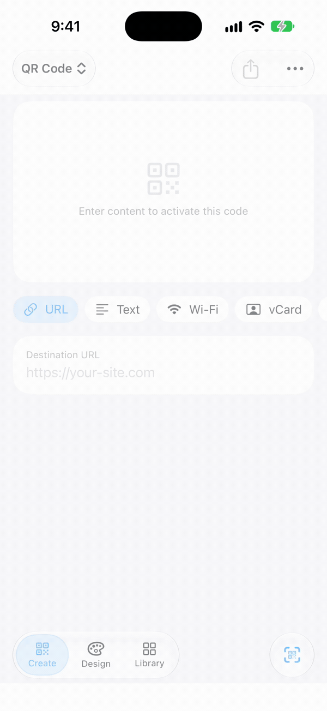
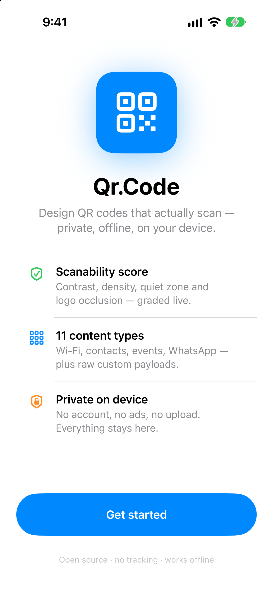
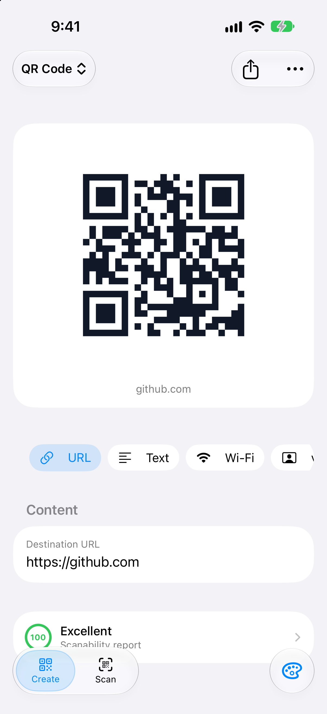
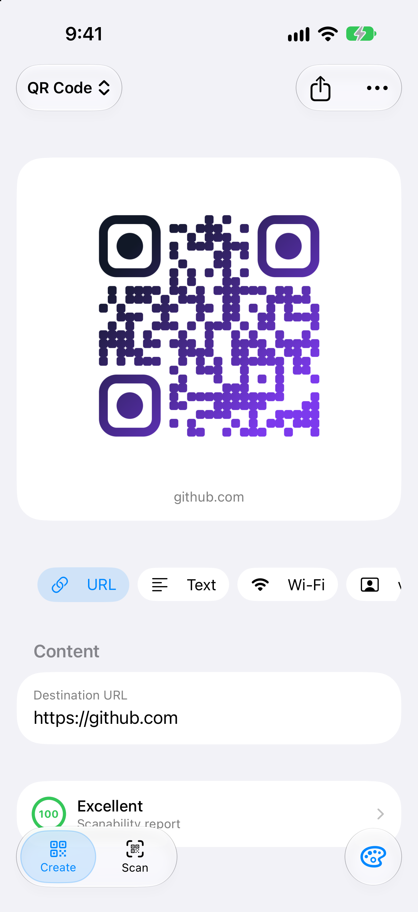
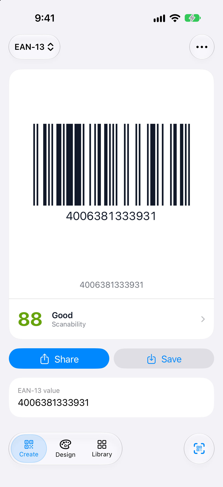
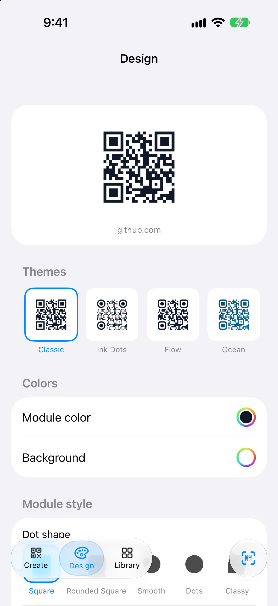
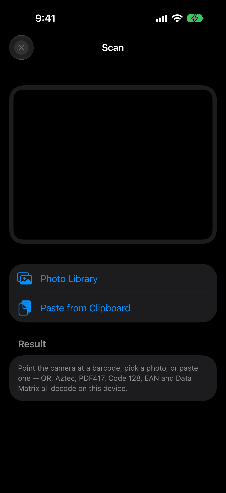
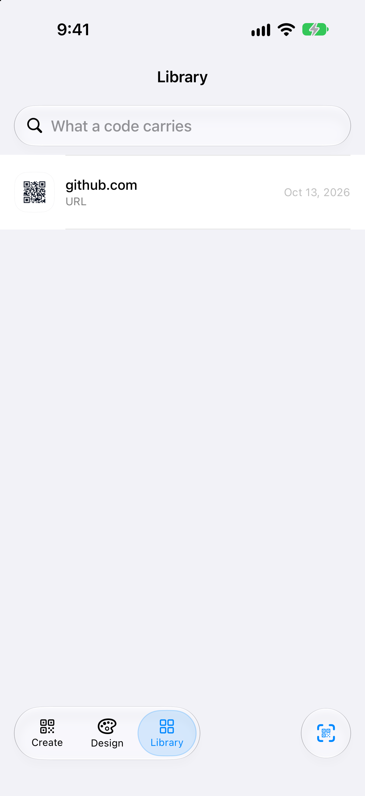

<p align="center">
  
</p>
<p align="center">
  <a href="Screenshots/demo.mp4">Watch in full quality (MP4)</a>
</p>

<table>
  <tr>
    <td></td>
    <td></td>
    <td></td>
    <td></td>
  </tr>
  <tr>
    <td></td>
    <td></td>
    <td></td>
    <td></td>
  </tr>
</table>

# Qr.Code

A QR code design studio in two implementations, sharing a payload vocabulary, a
scanability model and a design language.

- **iOS app** — `Sources/`, `Tests/`, `ShareExtension/`. Swift 6, SwiftUI and
  Vision; generates and scans QR, Aztec, PDF417, Code 128, EAN-13 and EAN-8.
- **Web studio** — `web/`. React 19, TypeScript and Vite; adds SVG export and
  bulk CSV generation. This is the app the iOS edition is a port of.

Both are offline-first: nothing you type, scan or generate leaves the device.

## Scanability

Most QR tools will produce an unreadable code without warning. This one scores
the design before export — contrast, module density, quiet zone, logo
occlusion, styling cost — and reports the checks behind the score.

The score is backed by tests rather than judgement. `RoundTripTests` renders a
symbol and decodes it with the same Vision framework real scanners use, across
every module style, every error-correction level, gradients, logo sizes and
each symbology. The logo slider's 0.35 ceiling is asserted decodable, so a
change that breaks scannability fails the build.

## Features

**Payload types (12)** — URL, text, Wi-Fi credentials, contact card, email,
SMS, phone, geo, calendar event, Bitcoin payment, WhatsApp, and a raw mode for
anything a scanner understands (SEPA/EPC transfers, deep links, proprietary
schemes).

**Symbologies (6)** — QR, Aztec, PDF417, Code 128, EAN-13, EAN-8. EAN check
digits are verified.

**Styling** — seven module shapes (square, rounded, smooth, dots, classy, leaf
and fluid); rounded or circular finder frames; gradients; transparent
backgrounds; centre logos; a theme gallery. Styled output is drawn as vector
paths from the symbol matrix, so it stays sharp at any export size.

**Export** — SVG for print (QR codes), PNG up to 4096 px, and a print-sized PDF
rasterised at 2048 px.

**Batch** — paste a list, get one PDF with a page per code, each page labelled
with the payload it encodes. The web studio writes individual files into a ZIP;
on iOS a single print-ready document needs no archive format, and the difference
is deliberate rather than missing.

**Context Band** — an optional strip below the code showing a call to action
and the destination, so a scan target is visible before scanning. The label is
derived from the payload type; a Wi-Fi password is never printed.

**System integration** — App Intents for Siri and Shortcuts, and a share
extension for turning a page or selected text into a code.

**Scanner** — camera, photo library and clipboard input. Decodes QR, Aztec,
PDF417, Code 128, EAN and Data Matrix.

## Architecture

| Layer | Files | Responsibility |
| --- | --- | --- |
| Model and encoding | `Models.swift`, `PayloadBuilder.swift`, `EANEncoder.swift`, `Scanability.swift` | Payload construction, EAN check digits, Bitcoin address checksums, scanability rules. Imports Foundation and CryptoKit only, so it is testable without a simulator. |
| Rendering | `QRRenderer.swift`, `StyledQRRenderer.swift` | Integer-pixel-per-module rasterisation, the vector path renderer, logo composition, the Context Band, PNG and PDF output. |
| Capture | `ScanViews.swift` | AVFoundation camera, Vision decoding, permission states. |
| Interface | `QRFlowApp.swift`, `AppModel.swift`, `CreateViews.swift`, `CreateFormViews.swift`, `HistoryViews.swift`, `ComponentViews.swift`, `OnboardingViews.swift` | One `@Observable` model holds state, navigation and persistence. The bar carries three destinations — Create, Design, Library — and the scanner opens as a camera cover rather than claiming a fourth. |
| Integration | `QRFlowIntents.swift`, `ShareExtension/` | App Intents and the share extension, built against the same renderer. |

Constraints held throughout: no third-party dependencies, no network code, and
no UI imports below the view layer.

## Build

Requires Xcode 26 or newer; the deployment target is iOS 26.0.

```bash
open QRFlow.xcodeproj
```

## Tests

```bash
xcodebuild -project QRFlow.xcodeproj -scheme QRFlow \
  -destination 'platform=iOS Simulator,name=iPhone 18 Pro' test
```

Replace the destination with an installed simulator (`xcrun simctl list devices
available`). 70 tests, all passing.

The web studio carries its own suite: `cd web && npm run verify` runs the
linter, 17 tests and a production build.

| Area | Coverage |
| --- | --- |
| Round trips | Every module style × every error-correction level, gradients, dense payloads, and the linear symbologies — each rendered and decoded with Vision. |
| Logo ceiling | Decodability asserted up to the 0.35 the interface allows. |
| Payload correctness | Wi-Fi escaping, vCard CRLF and value escaping, wrapped and deterministic iCalendar records, WhatsApp encoding. |
| Bitcoin addresses | Base58Check and bech32/bech32m checksums. An invalid address is refused rather than encoded. |
| Scanability | Contrast, GS1 quiet zones per symbology, density and occlusion thresholds, preset contrast guarantees. |

## Accessibility

Toasts are announced to VoiceOver. Tappable rows are `Button`s, so Switch
Control and Full Keyboard Access can reach them. Controls containing text — the
tab capsule, theme thumbnails — scale with Dynamic Type.

## Privacy

The project contains no networking code. Camera images are decoded on device
and never leave it. The privacy manifest declares one UserDefaults reason
(`CA92.1`).

## Known limitations

- **iOS 26.0 minimum.** No `#available` fallbacks, which narrows the audience
  for a utility people install on whatever phone they have.
- **The Siri and Shortcuts intent stores the Wi-Fi password in plain text.**
  Shortcuts persists every parameter in the shortcut definition and its run
  history, and an app cannot mask or exclude it. The in-app field is a
  `SecureField`; that one is the system's to store.
- **The share extension is verified by compilation only.** The close button now
  lives in the extension's own view hierarchy; dismissing it on a device has
  not been tested.
- **Screenshots are light appearance only.** They are captured headlessly
  through the `-ui-*` launch hooks in `AppModel`, so regenerating them is a
  script rather than a manual pass.
- **Page curvature is not corrected**, only perspective.
- **`VNDetectBarcodesRequestRevision1`** is deprecated but still used in tests:
  newer revisions require an inference context that headless simulators cannot
  create.

## Licence

MIT. See [LICENSE](LICENSE).
